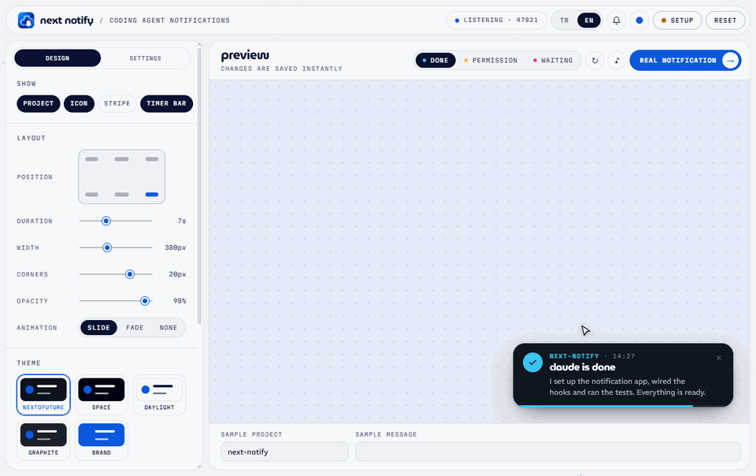

<p align="center"></p>

<h1 align="center">next notify</h1>

<p align="center"><b>English</b> &nbsp;|&nbsp; <a href="README.tr.md">Türkçe</a></p>

<p align="center">Desktop notifications for <a href="https://claude.com/claude-code">Claude Code</a>, Codex, Cursor, Gemini CLI and OpenCode on Windows, macOS and Linux.<br>
<sub>by Next to Future</sub></p>

<p align="center">
  <picture>
    <source media="(prefers-color-scheme: dark)" srcset="docs/demo-en-dark.gif">
    
  </picture>
</p>

Next Notify shows a notification when your coding agent **finishes a task**, **asks for permission** or **is waiting for you**. Each notification shows the agent, the project name, a short summary of the last reply and a sound picked for that event. Click the notification to go back to wherever the agent is running: the project's window in your editor (VS Code, Antigravity, Cursor and other VS Code-based editors), or the terminal window. This is detected automatically.

Design and settings are shared by every agent, so all of them look and sound the same.

## Install

**1. Install the app.** Download it from [Releases](../../releases/latest):

| Platform | File |
|---|---|
| Windows | `NextNotify-Setup.exe` |
| macOS (Intel and Apple silicon) | `NextNotify-Setup.dmg` |
| Linux | `Next-Notify-x.y.z-x86_64.AppImage` or `.deb` |

The app runs in the tray / menu bar and starts at login by default. It checks for a new version every time it starts, downloads it in the background and installs it silently once the settings window is closed.

**2. Connect your agent.** The *Setup* panel in the settings window shows the exact text for your system with a copy button. On Windows the commands use `curl.exe` and `%USERPROFILE%` instead of `curl` and `~`.

| Agent | Done | Permission | Waiting |
|---|:---:|:---:|:---:|
| Claude Code | ✓ | ✓ | ✓ |
| Codex | ✓ | ✓ | |
| Cursor | ✓ | | |
| Gemini CLI | ✓ | ✓ | |
| OpenCode | ✓ | ✓ | |

<details open>
<summary><b>Claude Code</b></summary>

Run these in Claude Code:

```
/plugin marketplace add ntofuture/next-notify
/plugin install next-notify@next-notify
```

If you only use the VS Code extension and the Claude Code CLI isn't installed, these commands may not work fully. Instead:

1. Type `/plugins` in the prompt box to open **Manage plugins**.
2. Add `ntofuture/next-notify` in the **Marketplaces** tab on the right.
3. Switch to the **Plugins** tab on the left, search for `next-notify`, install it and make sure it's turned on.

Then start a new Claude session. To check, run `/next-notify:test`.
</details>

<details>
<summary><b>Codex</b></summary>

Add this to `~/.codex/hooks.json` (merge the `hooks` section if the file already exists), then approve the hooks in Codex with `/hooks`:

```json
{
  "hooks": {
    "Stop": [{ "hooks": [{ "type": "command", "command": "curl -s -m 5 --data-binary \"@-\" http://127.0.0.1:47821/hook/codex" }] }],
    "PermissionRequest": [{ "hooks": [{ "type": "command", "command": "curl -s -m 5 --data-binary \"@-\" http://127.0.0.1:47821/hook/codex" }] }]
  }
}
```
</details>

<details>
<summary><b>Cursor</b></summary>

Add this to `~/.cursor/hooks.json` (merge the `hooks` section if the file already exists). Cursor only offers a hook for the end of a task.

```json
{
  "version": 1,
  "hooks": {
    "stop": [{ "command": "curl -s -m 5 --data-binary \"@-\" http://127.0.0.1:47821/hook/cursor" }]
  }
}
```
</details>

<details>
<summary><b>Gemini CLI</b></summary>

Add this to the `hooks` section of `~/.gemini/settings.json`:

```json
{
  "hooks": {
    "AfterAgent": [{ "hooks": [{ "type": "command", "command": "curl -s -m 5 --data-binary \"@-\" http://127.0.0.1:47821/hook/gemini" }] }],
    "Notification": [{ "hooks": [{ "type": "command", "command": "curl -s -m 5 --data-binary \"@-\" http://127.0.0.1:47821/hook/gemini" }] }]
  }
}
```
</details>

<details>
<summary><b>OpenCode</b></summary>

Save this as `~/.config/opencode/plugins/next-notify.js`. OpenCode loads it at startup.

```js
export const NextNotify = async ({ directory }) => {
  const send = (body) =>
    fetch('http://127.0.0.1:47821/hook/opencode', {
      method: 'POST',
      headers: { 'Content-Type': 'application/json' },
      body: JSON.stringify({ cwd: directory, ...body }),
    }).catch(() => {})
  return {
    event: async ({ event }) => {
      if (event.type === 'session.idle') await send({ hook_event_name: 'Stop' })
      if (event.type === 'permission.asked') await send({ hook_event_name: 'Notification', notification_type: 'permission_prompt', message: event.properties?.title ?? '' })
    },
  }
}
```
</details>

Antigravity's own agent has no documented hook yet. Claude Code running inside Antigravity works as usual.

## Customize

Open the settings window from the tray icon or with `/next-notify:dashboard`. Every change is previewed live and saved instantly.

- **Design:** 5 themes plus custom colors, position (6 corners), duration, width, corner radius, opacity, animation, separate fonts for the project, title and summary, and summary length.
- **Settings:** notifications on/off, start at login, sound on/off and volume, plus a separate title, message, icon, accent color, sound and "stay until dismissed" setting for *done*, *permission* and *waiting*.
- **Sounds:** built-in synthesized sounds, your system sounds or any audio file.
- **Language:** English and Turkish.

Titles and message templates can use these variables:

| Variable | Meaning |
|---|---|
| `{agent}` | Agent name: `claude`, `codex`, `cursor`, `gemini` or `opencode` |
| `{project}` | Project folder name |
| `{summary}` | Plain-text summary of the agent's last reply (done) |
| `{message}` | The agent's notification text (permission, waiting) |
| `{time}` | Time (HH:MM) |
| `{cwd}` | Full working directory |

## How it works

```
Claude Code ── http hook ──────────▶
Codex, Cursor, Gemini ── curl ─────▶  Next Notify app (127.0.0.1:47821) ──▶ notification + sound
OpenCode ── plugin (fetch) ────────▶
```

Each agent posts its own hook payload to `/hook` (Claude Code) or `/hook/<agent>`, and the app turns it into the same notification. The Claude Code plugin only contains two [HTTP hooks](https://code.claude.com/docs/en/hooks) (`Stop` and `Notification`) and two commands, so no shell scripts run. If the app isn't running, the hooks fail quietly and the agent keeps working.

Your data stays on your machine. The app listens only on `127.0.0.1` and rejects requests that come from a web page. The only outgoing request is the update check at launch.

## Platform notes

- **macOS:** the app is signed and notarized by Apple, and updates install automatically like on Windows.
- **Windows:** SmartScreen may warn about an unknown publisher. Choose **More info → Run anyway**.
- **Linux:** the card needs a compositor for transparency (standard on GNOME and KDE). Start-at-login writes `~/.config/autostart/next-notify.desktop`.

## Troubleshooting

- **No notifications:** open the settings window. The setup panel shows whether the app is listening and which agents are connected, and *Recent events* lists every hook that arrived with the agent's name. If nothing arrives, start a new session after connecting the agent.
- **Codex sends nothing:** run `/hooks` in Codex and approve the Next Notify hooks.
- **Port 47821 is busy:** another copy of Next Notify (or another program) is using it. Quit it and restart the app.

## Build from source

Requires Node.js 22.12+. The app is written in TypeScript; `tsc` compiles `src` and `scripts` into `app/out`, and every command below builds first.

```
cd app
npm install
npm start          # build and run in development
npm run build      # type-check and compile only
npm run dist       # build an installer for the current platform into app/dist
npm run icons      # regenerate the app and tray icons
npm run installer  # redraw the Windows installer screens (runs as part of dist)
```

`deploy.bat` (Windows) and `deploy.sh` (macOS, Linux) build the app with Node.js 24.14.0 from nvm and ask what to do:

- **Build**: the app folder without an installer, copied into `publish/` to try locally.
- **Installer**: asks for the version and copies the installer and update files to upload into `installer/`.
- **Upload**: runs `upload.bat` / `upload.sh`, which send `installer/` to the server. They hold the server credentials, so they are not in the repository.

Pushing a `v*` tag runs `.github/workflows/release.yml`, which builds all three platforms, signs and notarizes the macOS app, and publishes the release once every installer is attached.

Automatic updates are read from `https://storage.nextofuture.com/applications/next-notify` (`build.publish` in `app/package.json`). For a new version, upload the installers to that folder together with `latest.yml`, `latest-mac.yml`, `latest-linux.yml`, the mac `.zip` and the `.blockmap` files, the `.yml` files last. The app compares the SHA-512 hash in the `.yml` file with the download before installing it.

```
.claude-plugin/marketplace.json   marketplace (points to ./plugin)
plugin/                           Claude Code plugin: http hooks + commands
app/src/main/                     Electron main process: server, agent hooks, popups, tray
app/src/renderer/                 settings window, notification card, sounds
app/build/installer.nsh           Windows installer screens (NSIS)
app/scripts/                      icon and installer image generators
deploy.bat, deploy.sh             build and upload scripts (output: publish/, installer/)
docs/                             README images
```

## License

MIT. The fonts (REM, MuseoModerno, Martian Mono) are under the SIL Open Font License. The Next to Future name and NF symbol are not covered by the MIT license.
