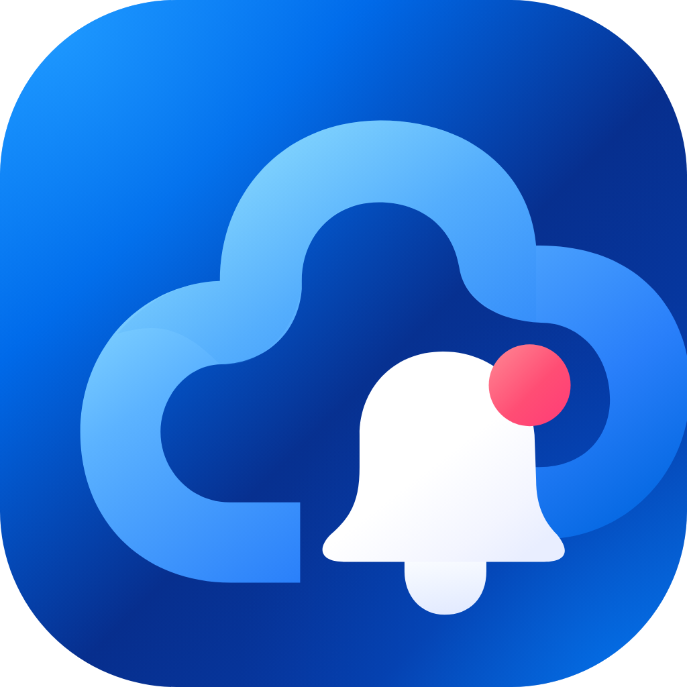
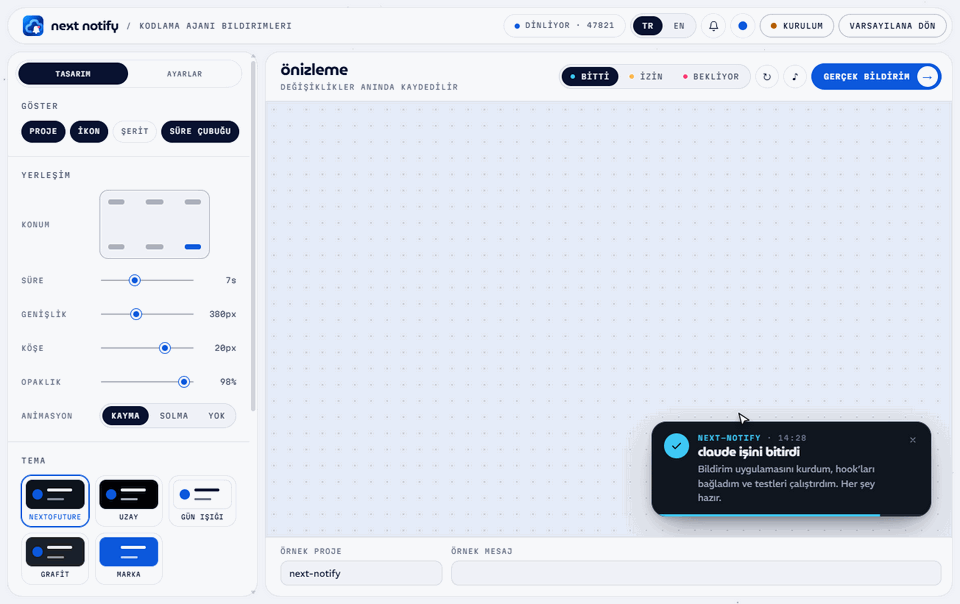

<p align="center"></p>

<h1 align="center">next notify</h1>

<p align="center"><a href="README.md">English</a> &nbsp;|&nbsp; <b>Türkçe</b></p>

<p align="center"><a href="https://claude.com/claude-code">Claude Code</a>, Codex, Cursor, Gemini CLI ve OpenCode için Windows, macOS ve Linux masaüstü bildirimleri.<br>
<sub>Next to Future</sub></p>

<p align="center">
  <picture>
    <source media="(prefers-color-scheme: dark)" srcset="docs/demo-tr-dark.gif">
    
  </picture>
</p>

Next Notify, kodlama ajanınız **bir görevi bitirdiğinde**, **izin istediğinde** ya da **sizi beklediğinde** bildirim gösterir. Bildirimde ajanın adı, proje adı, son yanıtın kısa bir özeti ve o olaya özel bir ses bulunur. Bildirime tıklayınca ajan nerede çalışıyorsa oraya dönersiniz: editördeki proje penceresi (VS Code, Antigravity, Cursor ve VS Code tabanlı diğer editörler) ya da terminal penceresi. Bu otomatik algılanır.

Tasarım ve ayarlar tüm ajanlar için ortaktır; hepsi aynı görünür ve aynı sesi çıkarır.

## Kurulum

**1. Uygulamayı kurun.** [Releases](../../releases/latest) sayfasından indirin:

| Platform | Dosya |
|---|---|
| Windows | `NextNotify-Setup.exe` |
| macOS (Intel ve Apple silicon) | `NextNotify-Setup.dmg` |
| Linux | `Next-Notify-x.y.z-x86_64.AppImage` ya da `.deb` |

Uygulama sistem tepsisinde / menü çubuğunda çalışır ve varsayılan olarak oturum açılınca başlar. Her açılışta yeni sürüm olup olmadığına bakar, varsa arka planda indirir ve ayar penceresi kapalıyken sessizce kurar.

**2. Ajanınızı bağlayın.** Ayar penceresindeki *Kurulum* bölümü, sisteminize uygun metni kopyalama düğmesiyle birlikte gösterir. Windows'ta komutlar `curl` ve `~` yerine `curl.exe` ve `%USERPROFILE%` kullanır.

| Ajan | Bitti | İzin | Bekliyor |
|---|:---:|:---:|:---:|
| Claude Code | ✓ | ✓ | ✓ |
| Codex | ✓ | ✓ | |
| Cursor | ✓ | | |
| Gemini CLI | ✓ | ✓ | |
| OpenCode | ✓ | ✓ | |

<details open>
<summary><b>Claude Code</b></summary>

Claude Code'da çalıştırın:

```
/plugin marketplace add ntofuture/next-notify
/plugin install next-notify@next-notify
```

Claude Code CLI kurulu değilse ve yalnızca VS Code eklentisini kullanıyorsanız bu komutlar tam çalışmayabilir. Bunun yerine:

1. Sohbet kutusuna `/plugins` yazıp **Manage plugins**'i açın.
2. Sağdaki **Marketplaces** sekmesinde `ntofuture/next-notify` adresini ekleyin.
3. Soldaki **Plugins** sekmesine geçin, `next-notify`'ı aratın, kurun ve açık olduğundan emin olun.

Ardından yeni bir Claude oturumu başlatın. Kontrol etmek için `/next-notify:test` komutunu çalıştırın.
</details>

<details>
<summary><b>Codex</b></summary>

Bunu `~/.codex/hooks.json` dosyasına ekleyin (dosya varsa `hooks` bölümünü birleştirin), ardından Codex'te `/hooks` ile hook'ları onaylayın:

```json
{
  "hooks": {
    "Stop": [{ "hooks": [{ "type": "command", "command": "curl -s -m 5 --data-binary \"@-\" http://127.0.0.1:47821/hook/codex" }] }],
    "PermissionRequest": [{ "hooks": [{ "type": "command", "command": "curl -s -m 5 --data-binary \"@-\" http://127.0.0.1:47821/hook/codex" }] }]
  }
}
```
</details>

<details>
<summary><b>Cursor</b></summary>

Bunu `~/.cursor/hooks.json` dosyasına ekleyin (dosya varsa `hooks` bölümünü birleştirin). Cursor yalnızca görev sonu için hook sunar.

```json
{
  "version": 1,
  "hooks": {
    "stop": [{ "command": "curl -s -m 5 --data-binary \"@-\" http://127.0.0.1:47821/hook/cursor" }]
  }
}
```
</details>

<details>
<summary><b>Gemini CLI</b></summary>

Bunu `~/.gemini/settings.json` dosyasının `hooks` bölümüne ekleyin:

```json
{
  "hooks": {
    "AfterAgent": [{ "hooks": [{ "type": "command", "command": "curl -s -m 5 --data-binary \"@-\" http://127.0.0.1:47821/hook/gemini" }] }],
    "Notification": [{ "hooks": [{ "type": "command", "command": "curl -s -m 5 --data-binary \"@-\" http://127.0.0.1:47821/hook/gemini" }] }]
  }
}
```
</details>

<details>
<summary><b>OpenCode</b></summary>

Bunu `~/.config/opencode/plugins/next-notify.js` olarak kaydedin. OpenCode açılışta yükler.

```js
export const NextNotify = async ({ directory }) => {
  const send = (body) =>
    fetch('http://127.0.0.1:47821/hook/opencode', {
      method: 'POST',
      headers: { 'Content-Type': 'application/json' },
      body: JSON.stringify({ cwd: directory, ...body }),
    }).catch(() => {})
  return {
    event: async ({ event }) => {
      if (event.type === 'session.idle') await send({ hook_event_name: 'Stop' })
      if (event.type === 'permission.asked') await send({ hook_event_name: 'Notification', notification_type: 'permission_prompt', message: event.properties?.title ?? '' })
    },
  }
}
```
</details>

Antigravity'nin kendi ajanı için henüz belgelenmiş bir hook yok. Antigravity içinde çalışan Claude Code her zamanki gibi çalışır.

## Özelleştirme

Ayar penceresini tepsi simgesinden ya da `/next-notify:dashboard` komutuyla açın. Her değişiklik canlı önizlenir ve anında kaydedilir.

- **Tasarım:** 5 tema ve özel renkler, konum (6 köşe), süre, genişlik, köşe yuvarlaklığı, opaklık, animasyon, proje, başlık ve özet için ayrı yazı tipleri ve özet uzunluğu.
- **Ayarlar:** bildirimleri açma/kapama, oturum açılınca başlatma, sesleri açma/kapama ve ses düzeyi; ayrıca *bitti*, *izin* ve *bekliyor* için ayrı başlık, mesaj, ikon, vurgu rengi, ses ve "kapatılana kadar kalsın" ayarı.
- **Sesler:** hazır sentezlenmiş sesler, sistem sesleri ya da istediğiniz bir ses dosyası.
- **Dil:** Türkçe ve İngilizce.

Başlık ve mesaj şablonlarında kullanılabilecek değişkenler:

| Değişken | Anlamı |
|---|---|
| `{agent}` | Ajanın adı: `claude`, `codex`, `cursor`, `gemini` ya da `opencode` |
| `{project}` | Proje klasörünün adı |
| `{summary}` | Ajanın son yanıtının düz metin özeti (bitti) |
| `{message}` | Ajanın bildirim metni (izin, bekliyor) |
| `{time}` | Saat (SS:dd) |
| `{cwd}` | Tam çalışma dizini |

## Nasıl çalışır

```
Claude Code ── http hook ──────────▶
Codex, Cursor, Gemini ── curl ─────▶  Next Notify (127.0.0.1:47821) ──▶ bildirim + ses
OpenCode ── plugin (fetch) ────────▶
```

Her ajan kendi hook verisini `/hook` (Claude Code) ya da `/hook/<ajan>` adresine gönderir; uygulama hepsini aynı bildirime çevirir. Claude Code plugin'i yalnızca iki [HTTP hook'u](https://code.claude.com/docs/en/hooks) (`Stop` ve `Notification`) ve iki komut içerir; hiçbir kabuk betiği çalışmaz. Uygulama kapalıysa hook'lar sessizce başarısız olur, ajan çalışmaya devam eder.

Verileriniz bilgisayarınızda kalır. Uygulama yalnızca `127.0.0.1` adresini dinler ve web sayfalarından gelen istekleri reddeder. Dışarıya giden tek istek, açılıştaki güncelleme kontrolüdür.

## Platform notları

- **macOS:** uygulama henüz Apple tarafından onaylanmadı (notarization). İlk açılışta uygulamaya sağ tıklayıp **Aç**'ı seçin ya da `xattr -cr "/Applications/Next Notify.app"` komutunu çalıştırın. macOS yalnızca imzalı uygulamalara güncelleme kurar; o zamana kadar yeni sürümleri Releases sayfasından indirin.
- **Windows:** SmartScreen "bilinmeyen yayıncı" uyarısı verebilir. **Ek bilgi → Yine de çalıştır**'ı seçin.
- **Linux:** kartın saydam görünmesi için bir pencere birleştirici gerekir (GNOME ve KDE'de varsayılan olarak bulunur). Oturum açılınca başlatma `~/.config/autostart/next-notify.desktop` dosyasını yazar.

## Sorun giderme

- **Bildirim gelmiyor:** ayar penceresini açın. Kurulum bölümü uygulamanın dinleyip dinlemediğini ve hangi ajanların bağlı olduğunu gösterir; *Son olaylar* gelen her hook'u ajan adıyla listeler. Hiçbir şey gelmiyorsa ajanı bağladıktan sonra yeni bir oturum başlatın.
- **Codex'ten bildirim gelmiyor:** Codex'te `/hooks` komutunu çalıştırıp Next Notify hook'larını onaylayın.
- **47821 portu meşgul:** başka bir Next Notify kopyası ya da başka bir program bu portu kullanıyor. Onu kapatıp uygulamayı yeniden başlatın.

## Kaynaktan derleme

Node.js 22.12 veya üstü gerekir. Uygulama TypeScript ile yazılmıştır; `tsc`, `src` ve `scripts` klasörlerini `app/out` altına derler ve aşağıdaki her komut önce derler.

```
cd app
npm install
npm start          # derler ve geliştirme modunda çalıştırır
npm run build      # yalnızca tip denetimi ve derleme
npm run dist       # bu platform için app/dist altına installer üretir
npm run icons      # uygulama ve tepsi simgelerini yeniden üretir
npm run installer  # Windows kurulum ekranlarını yeniden çizer (dist içinde çalışır)
```

`deploy.bat` (Windows) ve `deploy.sh` (macOS, Linux) uygulamayı nvm'deki Node.js 24.14.0 ile derler ve ne yapılacağını sorar:

- **Build**: kurulumsuz uygulama klasörünü lokalde denemek için `publish/` klasörüne kopyalar.
- **Installer**: sürümü sorar, yüklenecek installer ve güncelleme dosyalarını `installer/` klasörüne kopyalar.
- **Upload**: `installer/` klasörünü sunucuya gönderen `upload.bat` / `upload.sh` dosyasını çalıştırır. Bu dosyalar sunucu erişim bilgilerini içerdiği için depoda yer almaz.

`v*` biçiminde bir etiket gönderildiğinde `.github/workflows/release.yml` çalışır; üç platformun installer'larını derleyip taslak bir release'e ekler.

Otomatik güncellemeler `https://storage.nextofuture.com/applications/next-notify` adresinden okunur (`app/package.json` içinde `build.publish`). Yeni bir sürüm için installer'ları `latest.yml`, `latest-mac.yml`, `latest-linux.yml`, mac `.zip` ve `.blockmap` dosyalarıyla birlikte bu klasöre yükleyin; `.yml` dosyalarını en son yükleyin. Uygulama kurmadan önce indirilen dosyayı `.yml` içindeki SHA-512 özetiyle karşılaştırır.

## Lisans

MIT. Yazı tipleri (REM, MuseoModerno, Martian Mono) SIL Open Font License altındadır. Next to Future adı ve NF sembolü MIT lisansının kapsamında değildir.
